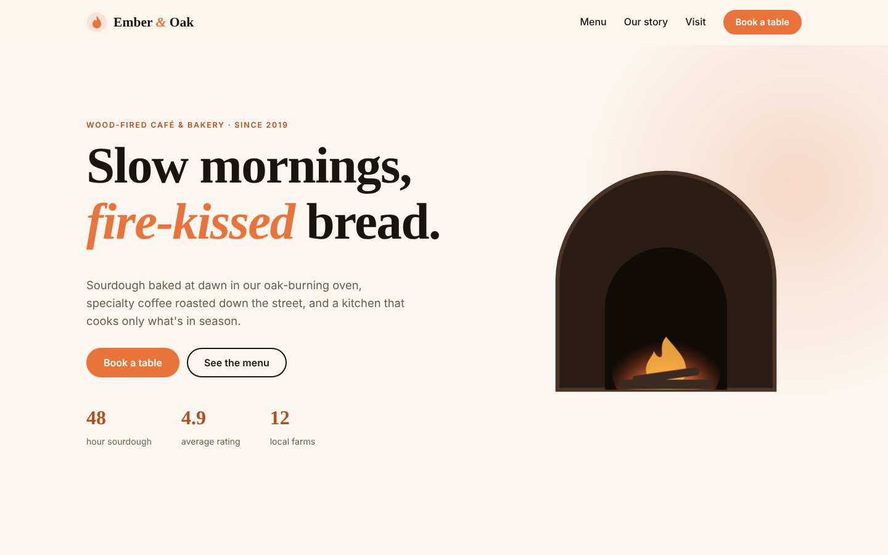
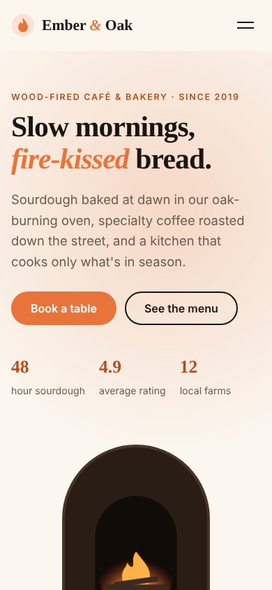

# Ember & Oak — Café & Bakery Website

A warm, story-driven website for a wood-fired café and bakery: tabbed menu, table booking form and live opening hours.

> Demo project by **[MoonWave](https://moonwave-studio.com)**. The business is fictional and the forms don't send anything.

**Live demo:** _coming soon_



<p align="center"></p>

## Features

- Animated wood-fired oven illustration (pure SVG + CSS, no images)
- Accessible menu tabs with keyboard arrow navigation
- Table booking form with inline validation, guest stepper and past-date protection
- "Open now / Closed now" status and today's hours highlighted automatically
- Scroll-reveal animations and count-up stats
- Mobile menu, sticky header, fully responsive from 320px
- Respects prefers-reduced-motion, skip link, visible focus states
- SEO meta tags and Open Graph

## Tech stack

- Semantic HTML5
- Modern CSS (custom properties, grid, flexbox, `clamp()`, keyframe animations)
- Vanilla JavaScript (IntersectionObserver, no frameworks, no build step)
- Zero dependencies: loads fast and deploys anywhere

## Run locally

Open `index.html` in a browser, or serve the folder:

```bash
npx serve .
```

## Deploy

Static site: drag the folder into Netlify, or connect this repo with no build command and `.` as the publish directory.

## Want a site like this?

I build fast, animated websites for small businesses and startups.

- Studio: [moonwave-studio.com](https://moonwave-studio.com)
- Hire me on [Upwork](https://www.upwork.com/freelancers/~01f7f6a71cc800d79b)

---

© MoonWave. All rights reserved. See [LICENSE](LICENSE).
